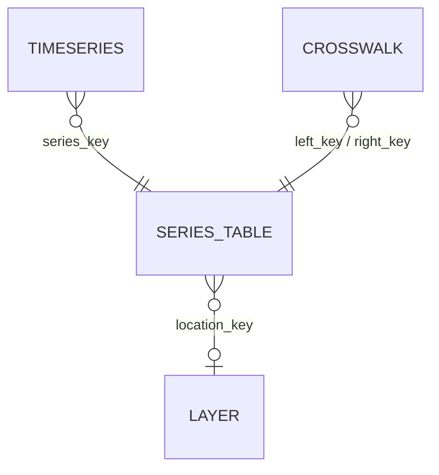

# Concepts

## Projects

A **project** is a workspace you share with others: its own datasets, evaluations and runs, and
its own members. Each member has a role:

| Role | Can |
| --- | --- |
| `read` | read the project's datasets, evaluations and results |
| `write` | also upload data, save evaluations and start runs |
| `admin` | also manage members and the project |

The **`public`** project holds data everyone signed in can read (observations, model outputs,
crosswalks); the platform writes it. Anywhere a dataset is named (a spec, a CLI command),
`public.<name>` is one of `public`'s and a bare `<name>` is the current project's. So comparing
your own forecasts with public observations is an ordinary evaluation in your project.

## Datasets

A **dataset** is one table. There are a few kinds:

- **Timeseries:** values over time from one source, e.g. `usgs_streamflow` (observed) or
  `nwm31_short_range` (forecast). A timeseries holds **one variable, in one unit**, with one
  meaning per value; that's recorded on the dataset, not on every row:
  - **role:** `observed`, `simulated` or `forecast`;
  - **variable:** e.g. `streamflow`, from the variable registry, with its canonical unit;
  - **unit:** values are stored in the variable's canonical unit (converted on upload);
  - **statistic:** what a value is: `inst` (a reading at an instant), or `mean`, `sum`, `min`,
    `max` over its **period** (e.g. `hour_starting`).

  Every row has `series_key`, `value_time` and `value`; forecasts add `reference_time` (when the
  forecast was issued); ensembles `member`; probabilistic forecasts `quantile`; observations may
  have `quality` codes.
- **Series table:** one row per series of a timeseries (made with it, named `<name>_series`): its
  attributes, and where it is (`location_key` in a layer).
- **Layer:** locations with geometry, e.g. gages or basins, keyed by `location_key`.
- **Crosswalk:** which series of one timeseries go with which of another (`left_key`,
  `right_key`), e.g. a USGS gage to its NWM reach.
- **Table:** anything else, including what runs write (results, pairs, state).

A **series** is one time series in a dataset, named by its **series key**, e.g. `usgs-01646500`
(one gage) or `nwm31-8786017` (one NWM v3.1 reach). Keys say where they come from, including the
model version, so a crosswalk for one NWM version can't silently pair another's reaches.

## Evaluations

An **evaluation** is a spec saved under a name in a project: what to compare, how to pair it, and
which metrics to compute for which groups. Saving a changed spec makes a new **version**; versions
never change, so a result always says exactly what produced it.

Every evaluation goes through the same steps:

`inputs → pair → fields → filter → aggregate → output`

- **inputs:** the observed (primary) dataset and one or more simulated or forecast (secondary)
  ones, each optionally filtered.
- **pair:** match secondary series to primary series (through a crosswalk, or a shared
  attribute), convert units, and match values at the same time. Each match is a **pair**.
- **fields:** derived columns, e.g. a lead-time bin or the month.
- **filter:** drop pairs, e.g. low flows.
- **aggregate:** group the pairs and compute metrics per group, e.g. KGE per gage and product;
  later stages can summarize earlier ones (the median KGE across gages).
- **output:** the unit results are in, and whether to keep the pairs.

The [spec guide](https://github.com/RTIInternational/teehr-core/blob/main/docs/spec/README.md)
documents each step.

## Runs and results

A **run** computes one version of an evaluation as a job in the cloud, acting as you: it reads
the data you can read, with your permissions. A version runs one at a time.

Each version writes three tables in its project:

| Table | Holds |
| --- | --- |
| `results_<name>_v<version>` | the metrics, **every run's rows** (`run_id` says which run) |
| `pairs_<name>_v<version>` | the pairs, the latest run's (when the spec keeps pairs) |
| `state_<name>_v<version>` | per month, what the next run builds on (see below) |

`teehr runs results <run id>` reads one run's results; `teehr datasets read
results_<name>_v<version>` reads the whole table, every run's rows.

Runs are **incremental** when they can be: after the first run, a run recomputes only the months
whose input data changed since the last one and merges them with the kept state, so rerunning
after new data arrives is quick. `--full` recomputes everything. A run's result says which it
did, and why when it was full.

## Personal tokens

`teehr auth login` makes a **personal token**: a secret that acts as you, saved on your computer.
Each computer, script or CI job gets its own, which you can list and revoke. See
[Tokens and access](tokens.md).
