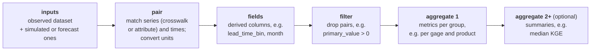

# Evaluations and runs

An evaluation is a spec saved under a name in a project; a run computes one of its versions.
The [spec guide](https://github.com/RTIInternational/teehr-core/blob/main/docs/spec/README.md)
documents everything a spec can say; this page covers working with them.

## A spec

```yaml
version: 1
name: nwm31-vs-usgs-by-lead-time
inputs:
  primary:
    dataset: public.usgs_streamflow
  secondary:
    - dataset: public.nwm31_short_range
    - dataset: public.nwm31_medium_range_mem1
      filter: "hour(reference_time) = 0"
pair:
  relation: public.usgs_nwm31
fields:
  - {name: lead_time_bin, fn: lead_time_bins, width: PT6H}
filter: "primary_value > 0"
aggregate:
  - group_by: [primary_series_key, secondary_dataset, lead_time_bin]
    metrics: [count, kling_gupta_efficiency, nash_sutcliffe_efficiency, root_mean_square_error]
output:
  unit: "[cft_i]/s"
  pairs: all
```

- **Datasets** are named as anywhere else: `public.<name>`, or a bare name for the project's own.
- **Metrics** have one canonical name (`nash_sutcliffe_efficiency`) and short aliases (`nse`,
  `kge`, `rmse`); results always use the canonical name. All 62, with their parameters and units,
  are in the [metrics reference](https://github.com/RTIInternational/teehr-core/blob/main/docs/metrics.md).
- **Filters and expressions** are a small SQL subset: comparisons, `AND`/`OR`/`NOT`, `IN`,
  `BETWEEN`, `LIKE`, and functions such as `hour()` and `date_trunc()`.
- **Units:** `output.unit` is the unit results are in (default: the primary dataset's). Any number
  with a unit in the spec says its unit (`{value: 1000, unit: "[cft_i]/s"}`).
- **`output.pairs: all`** keeps the pairs, in `pairs_<name>_v<version>`. They're by far the
  largest output (a row per pair, so millions for a big evaluation), so keep them when you'll
  look at them.

`teehr evaluations show <name> -p <project> > spec.yaml` copies an existing spec to start from.

## The steps

Every evaluation goes through the same steps, in this order; the [spec
guide](https://github.com/RTIInternational/teehr-core/blob/main/docs/spec/README.md) documents
each.



**Pairing** is the core step. For each observed series it finds the secondary series that go with
it (through the crosswalk), converts both to the evaluation unit, and matches values that cover
the same time ([periods](concepts.md#periods-the-time-a-value-covers)). Each match is a **pair**:

| primary_series_key | secondary_series_key | secondary_dataset | reference_time | value_time | primary_value | secondary_value |
| --- | --- | --- | --- | --- | --- | --- |
| usgs-01646500 | nwm31-4512772 | public.nwm31_short_range | 2026-10-11 06:00 | 2026-10-11 09:00 | 412.3 | 398.0 |

`secondary_dataset` says which product a pair came from, so one evaluation compares several
models or forecast products side by side. Fields add columns to the pairs (a `lead_time_bin` of
`PT0H-PT6H` here); groups are made of pairs.

## Metrics

Each first-stage metric is computed over the pairs of each group. A metric is a name or an object
with options:

```yaml
metrics:
  - count
  - kge                                                   # an alias
  - {name: nse, transform: log, as: log_nse}              # on log values, its own column name
  - {name: hits, threshold: {value: 1000, unit: "[cft_i]/s"}}
  - {name: kge, sr: 1, sa: 0.5, sb: 0.5, as: kge_weighted}
```

The [metrics reference](https://github.com/RTIInternational/teehr-core/blob/main/docs/metrics.md) lists every metric: its aliases, definition, parameters
(e.g. `threshold` for the contingency metrics, required), the unit of its result, and whether it
**merges** (see [rerunning](#rerunning-as-data-arrives)).

## Confidence intervals (bootstrap)

A metric from a few weeks of data is uncertain. A `bootstrap` block on the first stage gives every
metric in it an interval:

```yaml
aggregate:
  - group_by: [primary_series_key, secondary_dataset]
    metrics: [rmse, kge]
    bootstrap: {method: circular_block, block: P7D, reps: 1000, seed: 42}
```

Results gain `root_mean_square_error_q05` and `_q95`, and `kling_gupta_efficiency_q05` and
`_q95`: the 5th and 95th percentiles of each metric over 1,000 resamples of the group's pairs.
Block resampling draws runs of consecutive pairs (about a week here), because today's error is
correlated with yesterday's; resampling single pairs would make the intervals too narrow. The
same spec and seed always give the same intervals. Methods: `iid`, `circular_block`,
`stationary`, `year_block`; options are in the spec guide.

## Units of results

Values are compared in the evaluation unit (`output.unit`, default the observed dataset's), and
each metric's result follows from it:

| Metrics like | Are in |
| --- | --- |
| `mean_error`, `rmse`, `mean_absolute_error`, `max_value_delta` | the evaluation unit |
| `mean_square_error`, `variance` | the unit squared |
| `nse`, `kge`, correlations, relative errors, contingency scores | no unit |
| `max_value_time_delta` | seconds; timing signatures in days |

So the same spec with `output.unit: "[cft_i]/s"` gives an RMSE in cfs, and with `m3/s` in m³/s.
Ratios between units with different zero points (°C and °F) differ between units: evaluate in the
unit you want them in.

## Places on results

`output.geometry` gives each result row a place, so results can be mapped:

```yaml
aggregate:
  - group_by: [primary_series_key, secondary_dataset]
    metrics: [kling_gupta_efficiency]
output:
  geometry: primary_series_key     # each gage's location
  attributes: [huc_cd]             # and attributes of the same place, as columns
```

- `primary_series_key`: the observed series' location, from its series table's `location_key`
  in its layer (the dataset's `location_layer` unless a series says otherwise).
- A `within` field's name: the polygon of its layer, e.g. a basin.

The column must be in the last stage's `group_by`. Places are looked up when results are read
(`teehr runs results`): `--out results.geojson` writes a feature collection, `.parquet` and
`.arrow` keep a `geometry` column. A dataset read of the results table has no places: they're
not stored.

## Check, save, run

```
teehr evaluations plan spec.yaml -p my_project
```

**Plan** checks the spec against the project's datasets without saving or running anything. It
prints what the run will read (each input's dataset, role, variable and unit), the crosswalk, and
each aggregation stage's groups and columns:

```
The spec plans.
unit: [cft_i]/s
  primary: public.usgs_streamflow (observed, streamflow, in m3/s)
  secondary: public.nwm31_short_range (forecast, streamflow, in m3/s)
  secondary: public.nwm31_medium_range_mem1 (forecast, streamflow, in m3/s)
  crosswalk: public.usgs_nwm31
  stage 1: by primary_series_key, secondary_dataset -> count, kling_gupta_efficiency,
nash_sutcliffe_efficiency, root_mean_square_error, relative_bias, pearson_correlation
```

or every problem it finds: an unknown dataset or metric, a column that doesn't exist at that step,
a unit that doesn't convert, or a feature TEEHR doesn't support yet (below):

```
no dataset 'public.nwm31_shrt_range' in the public project
```

It also prints **warnings** about what the spec does that you may not expect, e.g. that every run
of it is full (and why), so reruns won't be incremental.

```
teehr evaluations save nwm31_by_lead nwm31-by-lead.yaml -p my_project
```

**Save** plans it too, then stores it as version 1. Saving again with a changed spec makes the
next version; saving a spec that means the same (key order, aliases and defaults aside) changes
nothing. Versions never change. Names are lowercase letters, digits and underscores, starting
with a letter, at most 45 characters.

```
teehr runs start nwm31_by_lead -p my_project --wait
```

**Run** computes the latest version (`--version N` for another) as a job that acts as you. A
version runs one at a time: starting another while one is going is refused. With `--wait`:

```
id: f327bf66-83f5-4ee2-8408-fdf48e0ad976
evaluation: nwm31_by_lead
version: 1
status: succeeded
results_dataset: results_nwm31_by_lead_v1
rows: 6
mode: full (no earlier run kept state)
pairs: 252 rows in pairs_nwm31_by_lead_v1
```

## Rerunning as data arrives

After the first run, runs are **incremental** when they can be: a run recomputes only the months
whose input data changed since the last run (uploads and ingests record the months they touch),
and merges them with the state the last run kept. So a daily rerun after new observations arrive
reads days, not years.

```
teehr runs start nwm31_by_lead -p my_project --wait          # incremental when it can be
teehr runs start nwm31_by_lead -p my_project --full --wait   # recompute everything
```

The run's `mode` says which it did, and why when it was full (e.g. "no earlier run kept state",
or an input whose layer changed).

### What makes every run full

Incremental runs need every first-stage metric to be computable from **state**: running sums kept
per group and month, which merge. A spec that can't keep state runs **full every time**: no
incremental reruns, and all its data read and computed in one pod, so a very large evaluation may
not fit. `plan` warns when that's so, and why:

```
warning: every run is full (no incremental reruns; all the data is read and computed in one pod,
so very large evaluations may not fit): spearman_correlation needs every pair, not running sums
```

What causes it:

- a metric that doesn't merge: `spearman_correlation`, `center_of_timing`,
  `standard_deviation_of_timing`, `annual_peak_flow_bias`, `rank_histogram_reliability` (the
  **Merges** column of the [metrics reference](https://github.com/RTIInternational/teehr-core/blob/main/docs/metrics.md));
- `guards`, `reduce` windows, skill matched on observations, and some `bootstrap` settings.

To get back to incremental runs, move those metrics to an evaluation of their own: the large,
frequent one stays incremental, and the other runs full when you need it.

## Not supported in TEEHR yet

The spec is shared with VeriRace, so the [spec
guide](https://github.com/RTIInternational/teehr-core/blob/main/docs/spec/README.md) describes
everything either system may run. In TEEHR, today:

| Feature | Status |
| --- | --- |
| `generate: climatology`, `generate: blend` inputs | **refused:** need a climatology dataset, which TEEHR can't make yet ([#251](https://github.com/RTIInternational/teehr-cloud-core/issues/251)) |
| `fn: percentile` field (`from:` a percentiles dataset) | **refused:** needs a percentiles dataset (#251) |
| `fn: naive_scale` field (for MASE) | **refused:** needs a naive_scale dataset (#251) |
| `generate: persistence` | supported |
| Answering small evaluations right away, `--estimate` (VeriRace's `evaluate`) | not in TEEHR: save, then run |
| Datasets of other projects (`<project>.<name>`) | not yet; `public.<name>` and the project's own |

`plan` refuses each with a message saying so. Two more depend on them:

- `mean_absolute_scaled_error` (`mase`): its `scale` comes from a `naive_scale` field;
- thresholds taken from a percentile field (`threshold: {column: q90}`).

What makes every run full is [above](#what-makes-every-run-full).

## Following runs

```
teehr runs list nwm31_by_lead -p my_project     # newest first
teehr runs show <run id> -p my_project          # status, results table, rows, mode, pairs
teehr runs logs <run id> -p my_project --follow # its log as it goes: plan, shards, writes
teehr runs wait <run id> -p my_project
teehr runs cancel <run id> -p my_project
```

A run's **log** is kept with it: what it planned to read, each shard (from every pod, with
retries), what it wrote, and why it failed if it did. `--follow` prints new lines until the run
ends. A run that fails also says why in `error`. Reading results is on
[Reading data and results](reading.md).

## Managing evaluations

```
teehr evaluations list -p my_project
teehr evaluations show nwm31_by_lead -p my_project               # the latest spec, as YAML
teehr evaluations show nwm31_by_lead -p my_project --version 1
teehr evaluations delete nwm31_by_lead -p my_project             # needs the admin role
```

Deleting an evaluation deletes its versions, runs and their tables, unless `--keep-results`
keeps the tables as datasets of their own.
