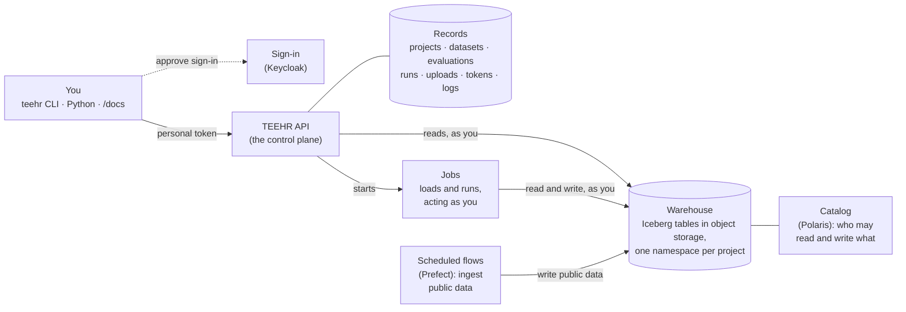
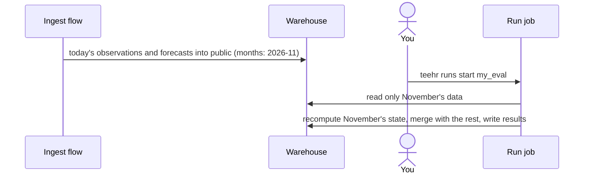

# How TEEHR Cloud fits together

## The pieces



- **The API** is the one door: the CLI, Python and the API docs at `/docs` all go through it. It
  keeps the records (who's in which project, what each dataset is, every evaluation version,
  run and upload, and their logs).
- **Data lives in the warehouse**, as Iceberg tables: each project has its own namespace,
  `public` holds the shared data. The catalog checks every read and write against your project
  roles, whether it comes from the API or a job.
- **Work that takes a while runs as a job**: loading an upload, running an evaluation. A job
  acts as you, with your permissions, and reports back to the API. A large run spreads over
  several pods.
- **Public data arrives on its own**: scheduled flows fetch observations and model output (USGS,
  NWM, ...) into `public`, recording which months each write touched.

## What happens when you run an evaluation

```mermaid
sequenceDiagram
    actor You
    participant API as TEEHR API
    participant Job as Run job (1 or more pods)
    participant WH as Warehouse

    You->>API: teehr runs start my_eval --wait
    API->>API: plan the spec again against the datasets as they are now
    API->>API: which months changed since the last run? (from the inputs' write records)
    API->>Job: start, acting as you: everything, or just those months
    Job->>WH: read the inputs (only those months, if incremental)
    Job->>Job: pair, compute fields and metrics (in shards, across pods)
    Job->>WH: write results, pairs and state, in one commit each
    Job->>API: report: rows, mode, snapshots read; log lines all along
    API-->>You: succeeded (or failed, with why)
```

A run reads every input at one snapshot, so data arriving meanwhile doesn't mix into it; the
run records which snapshots it read. The next run picks up from there.

## A day of new data



That's an **incremental** run: it recomputes only the months whose data changed. See
[Evaluations and runs](evaluations.md#rerunning-as-data-arrives).

## Where things live

| Thing | Where | How you get at it |
| --- | --- | --- |
| Projects, members, roles | the API's records | `teehr projects ...` |
| Datasets' metadata (role, variable, unit, ...) | the API's records | `teehr datasets show` |
| Datasets' rows | the warehouse, `<project>.<dataset>` | `teehr datasets read` |
| Uploaded files, before they're loaded | staging storage | `teehr uploads ...` |
| Evaluation specs, every version | the API's records | `teehr evaluations show` |
| Run results, pairs, state | the warehouse, `results_` / `pairs_` / `state_<name>_v<version>` | `teehr runs results`, `teehr datasets read` |
| Run and load logs | the API's records | `teehr runs logs`, `teehr uploads logs` |
| Your personal tokens | the API (hashed); your computer (`~/.config/teehr`) | `teehr tokens list` |
