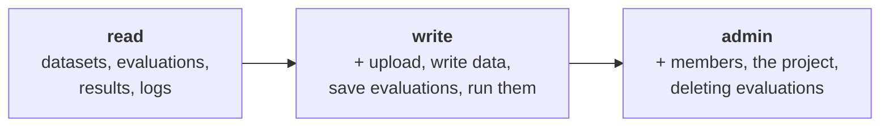

# Tokens and access

## Personal tokens

`teehr auth login` makes a **personal token** and saves it on your computer. A token acts as you,
with your current roles: a role you gain or lose applies to the token too (within a few minutes). Each computer,
script or CI job should have its own, so you can revoke one without the others.

```
teehr auth login                         # this computer: named after it, 90 days
teehr auth login --name ci --days 30     # one to give a CI job
teehr auth login --read-only             # can't upload, save or run
teehr auth login -p my_project           # only this project (repeat -p for more)
```

Tokens last 1 to 365 days (90 by default). Signing in shows a code and opens your browser;
approve only a code you just started yourself. The token's secret is shown once, to the command
that made it (`auth login` saves it); the API keeps only a hash, so a lost token can't be
recovered: revoke it and make another.

```
teehr auth status          # who you are, and this computer's token
teehr tokens list          # your tokens: when each expires and was last used
teehr tokens revoke <id>   # it stops working at once, with any job it started
teehr auth logout          # revoke this computer's token and forget it
```

Tokens are saved per API in `~/.config/teehr/credentials.json` (or under `$XDG_CONFIG_HOME`, or
`$TEEHR_CONFIG_DIR`), readable by you only. The API you signed in to last is the default;
`--api` picks another.

## Scripts and CI

Make a token for the job, then give the job two variables, keeping the token in the CI system's
secrets:

```
TEEHR_API_URL=https://control-plane.teehr.rtiamanzi.org
TEEHR_TOKEN=tpat_...
```

`teehr` and `Client.from_config()` use them in place of a saved token. Or save the token on the
machine with `teehr auth login --token tpat_...`. `TEEHR_PROJECT` sets the default `-p`.

## In the API docs and with HTTP

A token works as a bearer token on every API route:

```
curl -H "Authorization: Bearer tpat_..." https://control-plane.teehr.rtiamanzi.org/v1/projects
```

In the API docs at `/docs`, paste it into **Authorize**.

## Who can do what

Your project roles decide what you can do, wherever you do it: the CLI, Python, HTTP or the jobs
your runs and uploads start.



- **Not a member:** the project doesn't exist, as far as you can tell (404), except `public`, which
  everyone signed in reads.
- **A project always keeps an admin:** removing or demoting the last one is refused.
- **Platform admins** (very few people) can act on every project; **project creators** (an
  account role) can make new projects.

Project admins manage members:

```
teehr projects members list -p my_project
teehr projects members add alice -p my_project --role write
teehr projects members set alice -p my_project --role admin
teehr projects members remove alice -p my_project
```

and the project itself: `teehr projects show|update|delete my_project`, and `teehr projects
provision my_project` to retry setting up its storage if `status` says it failed.
